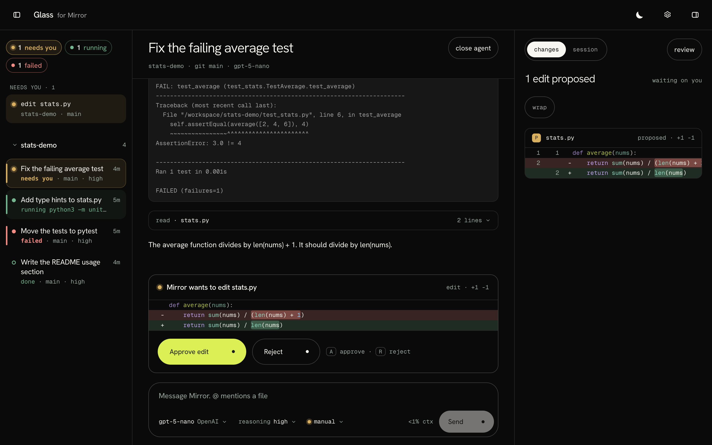
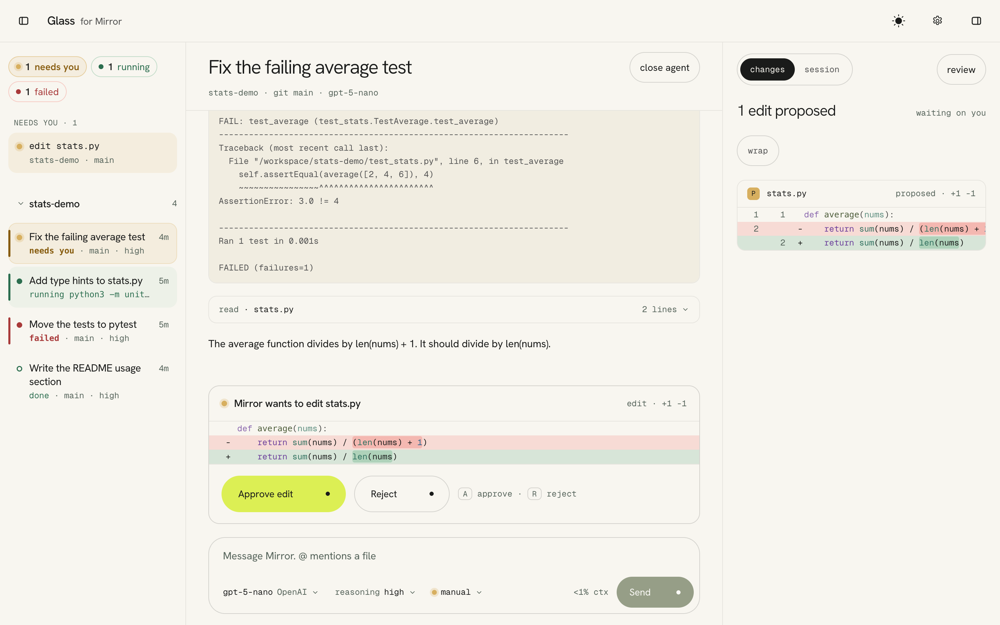
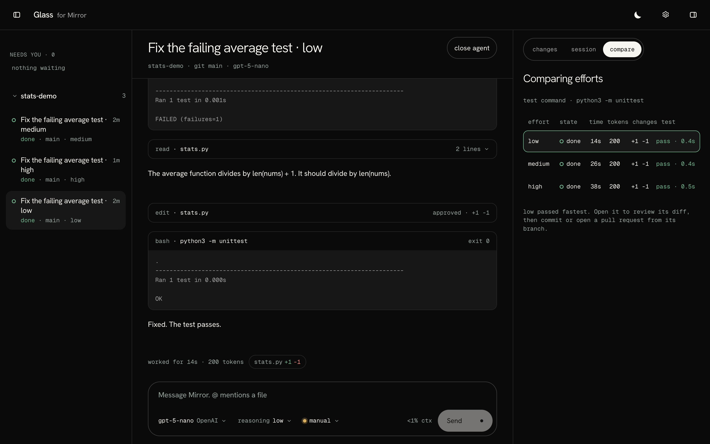

# Glass

An unofficial desktop app for [Mirror](https://github.com/reflection-oss/mirror), Reflection's agent harness. Many agents side by side, every approval in one place, the diff next to the conversation.



**[Watch the 33-second demo](docs/glass-demo.mp4)**: the real app with gpt-5-nano. Start an agent with ⌘K, approve its edit, see the tests pass, then the diff and the session.

Glass does not reimplement the agent. It launches Mirror's own worker, `mirror-agent`, and talks to it over the same gRPC protocol Mirror's terminal app uses. Same agent, same tools, same prompts. A different window.

Not affiliated with or endorsed by Reflection AI.

## What it does

- **Many agents at once.** Each agent is its own Mirror worker. The sidebar groups them by project and shows what each one is doing: running a command, thinking, waiting for you, done or failed. The ones that need you come first.
- **Approvals in one place.** In manual mode Mirror asks before it edits a file or runs a command. Every waiting request, from every agent, sits at the top of the sidebar. `A` approves, `R` rejects, and a notification takes you to the right agent.
- **Always allow, shared with Mirror.** Approve a command once with **Always allow** and it runs without asking from then on, in that workspace. Rules live in Mirror's own `~/.mirror/tool_approvals.json`, so they work in Mirror's CLI too, and the CLI's work in Glass.
- **The diff next to the chat.** The changes panel shows the workspace diff as the agent works. Click a line to comment on it; your comments go back to Mirror as one message.
- **Its own checkout.** A second agent in the same project gets a fresh checkout from `origin/main` on its own branch, so agents never edit each other's files.
- **Commit, push or open a pull request** from the changes panel. Pull requests use the GitHub CLI.
- **Rewind** to any earlier message, with the files put back as they were.
- **Compare efforts.** Run one task at several reasoning efforts, each in its own checkout. Glass runs your test command in each and shows which passed, how long it took and how many tokens it used.
- **Mirror's skills, memory and MCP servers,** with a settings screen for each, so nobody has to hand-write a `SKILL.md`. Import memories from Claude Code and Codex with Mirror's own import. Web search when a Firecrawl key is set.
- **Mirror's views and defaults.** Detail, default and focus transcript views, as Mirror's `/view` (⌘T). **Compact now** runs Mirror's own compaction. New agents start at Mirror's default effort, max, in the approval mode you saved in Mirror, and models saved in `~/.mirror/models.json` appear in the picker.
- **Every Mirror provider:** Reflection, ChatGPT plan through a Codex login, OpenAI, Anthropic, OpenRouter, or any OpenAI-compatible endpoint. Keys Mirror saved are used as they are.
- **A terminal per agent,** in a drawer below the chat or docked to the right.
- **Cream and dark themes,** keyboard shortcuts throughout (hover any button to see its shortcut).

<p>
  
  
</p>

## Getting started

You need a Mac with Apple silicon (tested on macOS 26) and [Mirror](https://github.com/reflection-oss/mirror) installed (`uv tool install reflection-mirror`). Glass finds your installed `mirror-agent`; it never bundles or changes it.

### Download

Get `Glass-0.2.0-macos-arm64.zip` from the [latest release](https://github.com/MustafaK99/Glass/releases/latest), unzip it and move Glass to Applications.

**macOS will warn you the first time.** Glass is not signed with an Apple Developer ID or notarised, so macOS says it cannot check it for malicious software. To open it anyway, open Glass once and close the warning, then click **Open Anyway** next to Glass in System Settings › Privacy & Security. Or run:

```bash
xattr -dr com.apple.quarantine /Applications/Glass.app
```

### Build from source

With Rust and Node 22 or newer:

```bash
cd app && npm install && npx tauri build --bundles app
open ../target/release/bundle/macos/Glass.app
```

On first run Glass checks that Mirror is installed and that a provider key is available.

### Provider keys

Glass reads keys from your shell profile, the same variables Mirror uses: `REFLECTION_API_KEY`, `OPENAI_API_KEY`, `ANTHROPIC_API_KEY`, `OPENROUTER_API_KEY`. You can also add a key in Settings, which saves it only in the macOS Keychain.

Keys never go in Glass's files or logs. A key reaches the worker only through its environment at launch, the app shows only its last four characters, and it is blanked out of any worker output Glass shows.

Pick the model in the composer: Reflection, OpenAI, Anthropic, OpenRouter, or any OpenAI-compatible endpoint, including a local one that needs no key.

## MCP servers

Glass reads Mirror's own MCP config, one file per server in `~/.mirror/mcp/` (or `$MIRROR_MCP_DIR`):

```json
{"command": "npx", "args": ["-y", "some-mcp-server"], "env": {"API_KEY": "SOME_API_KEY"}}
```

```json
{"url": "https://example.com/mcp", "auth": {"type": "bearer", "tokenEnvVar": "EXAMPLE_TOKEN"}}
```

`env` and `tokenEnvVar` name variables; the values never go in the file. New agents get the tools, `@` lists the servers, and Mirror asks before each call in manual mode. Servers that need an OAuth sign-in are listed but not used yet.

## Development

```bash
cd app && npm install && npx tauri dev    # the app, with hot reload
cd app && npx vitest run                  # UI tests: they replay recorded sessions
cargo test --workspace                    # Rust tests
```

### No model key needed

`dev/fake_model.py` is a scripted OpenAI-compatible endpoint. It replays a fixed fix-the-failing-test run, so the whole loop (streaming, approvals, tool calls) runs against the real worker for free.

```bash
cargo build -p glass-core
python3 dev/fake_model.py 18431 dev/fix-failing-test.script.json /tmp/glass-log "$PWD/path/to/stats-demo" &
GLASS_API=openai-chat-completions GLASS_MODEL=fake GLASS_BASE_URL=http://127.0.0.1:18431/v1 \
  ./target/debug/probe --approve path/to/stats-demo "Fix the failing test."
```

`probe` runs one prompt and prints every event as a JSON line. `--auto` lets the agent run every tool, `--approve` says yes to each request, neither says no, and `--record FILE` saves the events. `fixtures/` holds event streams recorded from the real worker; the UI tests fold them, and `npm run dev` in `app/` shows them at `?preview=fleet`, `?preview=race` and others (see `app/src/dev/preview.ts`).

### Layout

```
crates/core/      the Mirror client: worker launch, session, events, the probe
app/src/          React UI
app/src-tauri/    Tauri shell: agents, git, keys, MCP, terminal
proto/            Mirror's protocol files (see NOTICE)
dev/              scripted model and MCP server for tests
fixtures/         recorded event streams
docs/             product, design and architecture notes
AGENTS.md         project brief
```

Everything that depends on Mirror's protocol is in `crates/core`. Mirror's protocol is not documented and will change; when it does, that is the only place to fix.

## License

[Apache License 2.0](LICENSE), the same licence as Mirror. The protocol files under `proto/` come from Mirror's release; see [NOTICE](NOTICE).
